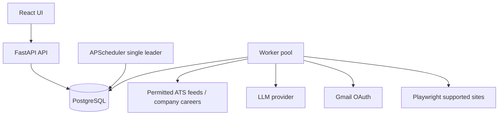

# JobPilot AI — Architecture and Implementation Plan

## Architecture decision
Personal MVP with SaaS-ready multi-tenant data model. Modular monolith, separate API/scheduler/worker processes, PostgreSQL durable jobs, React/TypeScript frontend, FastAPI backend. Application submission requires explicit per-application approval.

## HLD


## Core modules
- identity: users, sessions, OAuth connections, profile and preferences
- discovery: source adapters, fetch runs, normalization, deduplication, source provenance
- matching: hard eligibility gates, explainable scoring, LLM reasoning only after deterministic filtering
- resumes: immutable uploaded originals, versioned tailored resumes, generated answers, fact verification
- applications: state machine, approvals, submission attempts, evidence, timeline
- tracking: Gmail sync, message matching, status proposals, review queue
- notifications: digest, deadline and interview alerts
- operations: scheduled jobs, leases, retries, audit events, observability

## LLD: PostgreSQL schema
Every user-owned table includes user_id (UUID FK users.id) with indexed access paths. Shared public job postings may be global, while matches/applications are per-user.

- users(id UUID PK, email unique, password_hash nullable, created_at, deleted_at)
- profiles(id PK, user_id unique FK, full_name, graduation_year, degree, cgpa, location, work_preferences JSONB, skills JSONB, updated_at)
- oauth_connections(id PK, user_id FK, provider, encrypted_access_token, encrypted_refresh_token, scopes JSONB, expires_at, unique(user_id,provider))
- resumes(id PK, user_id FK, storage_key, sha256, version, original_resume_id nullable FK, generated_for_job_id nullable FK, created_at)
- sources(id PK, provider, name, base_url, fetch_strategy, enabled, last_success_at)
- source_fetch_runs(id PK, source_id FK, started_at, completed_at, status, fetched_count, error_code)
- jobs(id PK, company, title, location, remote_type, employment_type, description, requirements JSONB, first_seen_at, last_seen_at, closed_at)
- job_sources(id PK, job_id FK, source_id FK, external_id, canonical_url, last_seen_at, unique(source_id,external_id))
- user_job_matches(id PK, user_id FK, job_id FK, eligible, eligibility_reasons JSONB, score, scoring_version, scored_at, unique(user_id,job_id))
- saved_jobs(id PK, user_id FK, job_id FK, saved_at, unique(user_id,job_id))
- applications(id PK, user_id FK, job_id FK, resume_id nullable FK, state, applied_at, submitted_via, confirmation_reference, created_at, updated_at, unique(user_id,job_id))
- application_events(id PK, application_id FK, user_id FK, previous_state, next_state, event_type, evidence JSONB, created_at)
- application_drafts(id PK, application_id FK, answers JSONB, resume_id FK, version, created_at)
- submission_approvals(id PK, application_id FK, draft_id FK, user_id FK, approved_at, expires_at, consumed_at, status)
- submission_attempts(id PK, application_id FK, approval_id FK, idempotency_key unique, state, started_at, completed_at, evidence JSONB, error_code)
- email_messages(id PK, user_id FK, provider_message_id, thread_id, sender, subject, received_at, classification, unique(user_id,provider_message_id))
- status_suggestions(id PK, application_id FK, email_message_id FK, proposed_state, confidence, explanation, reviewed_at, decision)
- background_tasks(id PK, user_id nullable FK, task_type, payload JSONB, status, run_after, attempt, max_attempts, locked_by, lease_expires_at, idempotency_key, created_at, updated_at)
- notification_events(id PK, user_id FK, event_type, payload JSONB, delivered_at, status)
- audit_events(id PK, user_id nullable FK, actor_type, action, entity_type, entity_id, metadata JSONB, created_at)

Important indexes: background_tasks(status,run_after), background_tasks(lease_expires_at), applications(user_id,state), user_job_matches(user_id,eligible,score DESC), jobs(first_seen_at DESC), job_sources(source_id,external_id). Use foreign-key consistency and ownership checks, not merely client-supplied user IDs. Consider PostgreSQL RLS in SaaS phase.

## Application state machine
SAVED -> DRAFT -> READY_FOR_REVIEW -> APPROVED -> SUBMITTING -> APPLIED -> ASSESSMENT -> INTERVIEW -> OFFER or REJECTED. Alternative states: NEEDS_REVIEW, WITHDRAWN, EXPIRED. Never infer APPLIED from a click alone. Rejected/withdrawn transitions require evidence or user confirmation. Every transition creates an append-only event. Idempotency key prevents duplicate submission attempts, but external sites may not support exactly-once delivery; uncertain outcomes require manual review, not automatic retry.

## Scheduler / worker design
One active scheduler process calculates next runs. Persist schedules in database; APScheduler is a trigger engine, not the source of truth. A poller claims due background_tasks with SELECT ... FOR UPDATE SKIP LOCKED in short transactions, commits, then executes. Use worker leases and heartbeats; requeue expired leases only for idempotent tasks. Backoff with jitter and bounded retries. Rate-limit per source and account; comply with site terms and robots constraints where relevant. Never bypass CAPTCHA, MFA, or anti-bot controls. Manual fallback is first-class.

## Matching design
1. Deterministic hard filters: graduation year, degree, experience, location/work authorization, deadline, explicit restrictions.
2. Weighted fit score (illustrative): skill overlap 40%, role relevance 25%, location/work mode 15%, seniority 15%, preference 5%.
3. LLM may explain fit and extract structured requirements, but cannot fabricate qualifications. Record scoring version and reasons. Low-confidence eligibility goes to review.

## API contracts (v1)
- POST /api/v1/auth/login; GET /api/v1/me
- GET/PATCH /api/v1/profile; GET/POST /api/v1/resumes
- GET /api/v1/jobs?eligible=true&min_score=75; GET /api/v1/jobs/{id}; POST /api/v1/jobs/{id}/save
- POST /api/v1/discovery-runs; GET /api/v1/discovery-runs/{id}
- POST /api/v1/jobs/{id}/match; GET /api/v1/jobs/{id}/match
- POST /api/v1/applications; GET /api/v1/applications; GET /api/v1/applications/{id}
- POST /api/v1/applications/{id}/draft; POST /api/v1/applications/{id}/approve; POST /api/v1/applications/{id}/submit
- POST /api/v1/applications/{id}/status; GET /api/v1/applications/{id}/events
- POST /api/v1/integrations/gmail/connect; POST /api/v1/email-sync-runs; GET /api/v1/status-suggestions; POST /api/v1/status-suggestions/{id}/review
- GET /api/v1/tasks/{id}; GET /api/v1/dashboard/summary
All mutation endpoints enforce authentication, authorization, schema validation and idempotency where appropriate. Long-running endpoints return 202 Accepted with task ID.

## Repository layout
```
jobpilot/
  frontend/src/{app,features,components,lib}
  backend/app/
    main.py
    api/v1/{auth,profile,jobs,applications,integrations,operations}.py
    core/{config,security,logging}.py
    db/{base,session,migrations}.py
    modules/{identity,discovery,matching,resumes,applications,tracking,notifications,operations}/
    integrations/{ats,llm,gmail,browser}/
    workers/{scheduler,executor,handlers}.py
  tests/{unit,integration,e2e}
  infra/{docker,compose,monitoring}
  docs/{architecture,adr,api,runbooks}
```
Within modules, prefer models.py, schemas.py, repository.py, service.py and interfaces.py; integrations implement the interfaces.

## Delivery roadmap (suggested 8 weeks part-time)
Week 1: monorepo, Compose, auth, Alembic, profile, CI.
Week 2: jobs schema, manual links, dashboard, saved jobs.
Week 3: Greenhouse/Lever adapters, normalized ingestion, deduplication, scheduler.
Week 4: eligibility rules, scoring, match explanations, job alerts.
Week 5: application state machine, manual tracking, timeline, analytics.
Week 6: resume versioning, tailoring, fact validation, application drafts.
Week 7: Gmail OAuth, message sync, classification, reviewable status suggestions.
Week 8: one supported Playwright adapter, explicit approval, evidence, retries, E2E testing and deployment.

## MVP acceptance criteria
- User can define profile and import resume; user can find relevant 2027 fresher jobs from at least two permitted sources.
- Scheduled ingestion is idempotent; no duplicate postings for identical source IDs.
- Match explanations expose hard eligibility decisions and skill gaps.
- Every application is trackable manually with append-only history.
- No application is submitted without explicit approval; no uncertain submission auto-retries.
- Email-derived status changes are reviewable and traceable.
- Background work survives API restarts and produces observable execution records.
- Tests cover auth/ownership, source failures, duplicate jobs, status transitions, task leases and uncertain submission outcomes.

## Security and compliance
Encrypt OAuth tokens at rest with managed keys, use minimal Gmail scopes, allow disconnect and deletion, keep logs free of resume contents/tokens, redact PII in LLM prompts where possible, apply retention controls, isolate browser sessions, do not store third-party passwords, and comply with each platform's terms. Use authorized APIs and user-assisted flows over unauthorized scraping or anti-bot evasion.

## SaaS migration
Keep user_id throughout from day one; add organizations only if needed. Move object storage to S3-compatible service, use managed PostgreSQL, queue broker when throughput warrants, dedicated browser workers, per-tenant quotas, billing, tenant-level observability and data deletion. Do not split into microservices until deployment/scale justifies it.
